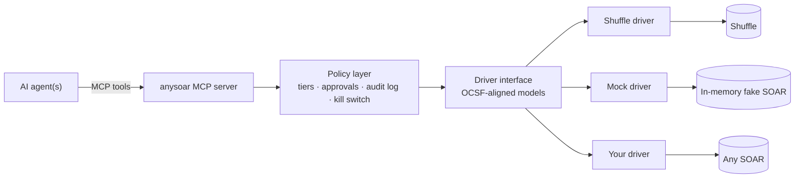

# anysoar

**One interface for AI agents to operate any SOAR platform.**

[](https://github.com/ag3ntsc4rn/anysoar/actions/workflows/ci.yml)
[](LICENSE)

> **Status: pre-alpha.** The repository is scaffolded and the package name is reserved, but
> nothing below the "Architecture" heading is implemented yet. Expect breaking changes.

## The problem

Security teams increasingly want to bring their own AI agents into the SOC: to triage alerts,
enrich indicators, and drive response. But every SOAR platform exposes a different API, data
model and playbook mechanism. An agent written against one SOAR has to be rewritten for the
next, which locks teams into whichever vendor they started with.

## The idea

anysoar is a vendor-agnostic adapter. Agents talk to anysoar; anysoar translates to whichever
SOAR sits underneath through a per-vendor **driver**. Swapping vendors means swapping a driver,
not rewriting agents.

- **One agent interface**: an [MCP](https://modelcontextprotocol.io) server exposing SOAR
  operations as tools.
- **One data model**: alerts, cases, observables and actions aligned with
  [OCSF](https://schema.ocsf.io) rather than a home-grown schema.
- **Guardrails built in**: a policy layer between the agent and the SOAR. Read actions run
  freely, write actions need human approval, destructive actions are blocked, and everything is
  written to an audit log with a kill switch.

## Architecture



## Install

```bash
pip install anysoar
```

The `0.0.x` releases contain only the package skeleton. Planned optional extras:

```bash
pip install "anysoar[mcp]"      # MCP server
pip install "anysoar[shuffle]"  # Shuffle driver
```

## Roadmap

1. **Data model and driver interface**: OCSF-aligned models; a driver contract with capability
   discovery.
2. **Mock driver**: an in-memory fake SOAR with synthetic alerts.
3. **MCP server and policy layer**: core tools, action tiers, approvals, audit log, kill switch.
4. **Reference agent**: an example phishing-triage agent running against the mock driver.
5. **Shuffle driver**: the first real SOAR, with the agent working unchanged.
6. **Console**: live agent reasoning and approve/reject for gated actions.
7. **Demo**: an end-to-end scenario including swapping the SOAR underneath a running agent.

## Repository layout

```
packages/anysoar/   the published Python package
apps/               example apps (agent, console); never published
demo/               demo environment and scenario
docs/               documentation
```

## Contributing

See [CONTRIBUTING.md](CONTRIBUTING.md). Please report security issues privately as described in
[SECURITY.md](SECURITY.md).

## License

[Apache 2.0](LICENSE)
