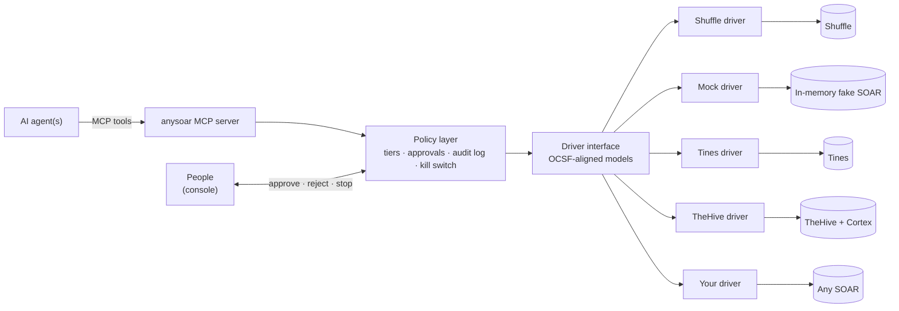
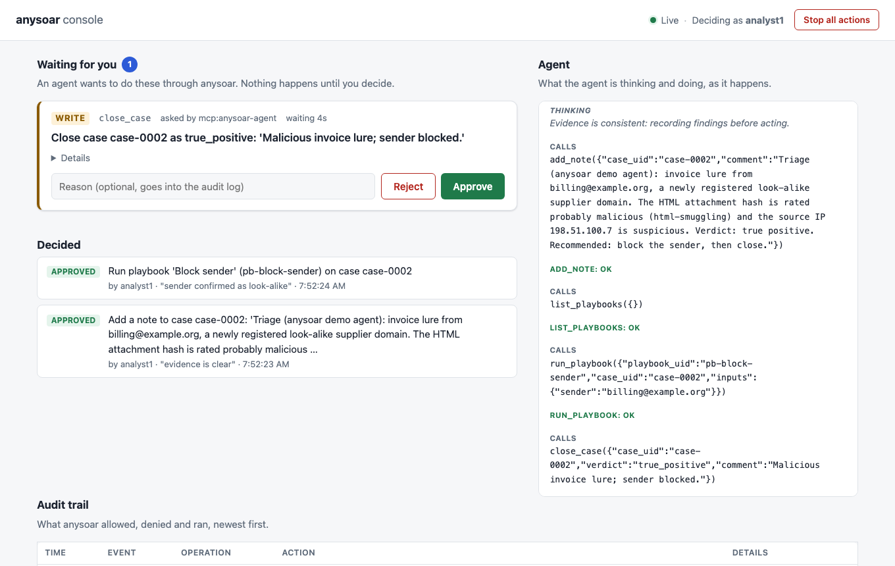

# anysoar

**One interface for AI agents to operate any SOAR platform.**

[](https://github.com/ag3ntsc4rn/anysoar/actions/workflows/ci.yml)
[](LICENSE)

> **Status: pre-alpha.** The OCSF-aligned data model, the driver interface, the policy
> layer, the MCP server, a reference triage agent, a web console for supervising agents, and
> four drivers exist: a mock (an in-memory fake SOAR), [Shuffle](https://shuffler.io),
> [Tines](https://www.tines.com) and [TheHive](https://strangebee.com/thehive/). Expect
> breaking changes.

## See it

```bash
demo/run.sh
```

An agent triages phishing cases while you approve its actions in a browser, and halfway
through you switch the SOAR underneath it, from a mock to a real TheHive with Cortex,
without restarting it: the same agent reads cases, looks their indicators up and writes its
notes there. `demo/run.sh --soar shuffle` switches to Shuffle instead. Needs
[uv](https://docs.astral.sh/uv/) and Docker; no API key. See
[demo/README.md](demo/README.md).

## The problem

Security teams increasingly want to bring their own AI agents into the SOC: to triage alerts,
enrich indicators, and drive response. But every SOAR platform exposes a different API, data
model and playbook mechanism. An agent written against one SOAR has to be rewritten for the
next, which locks teams into whichever vendor they started with.

## The idea

anysoar is a vendor-agnostic adapter. Agents talk to anysoar; anysoar translates to whichever
SOAR sits underneath through a per-vendor **driver**. Swapping vendors means swapping a driver,
not rewriting agents.

- **One agent interface**: an [MCP](https://modelcontextprotocol.io) server exposing SOAR
  operations as tools.
- **One data model**: alerts, cases, observables and actions aligned with
  [OCSF](https://schema.ocsf.io) rather than a home-grown schema.
- **Guardrails built in**: a policy layer between the agent and the SOAR. Read actions run
  freely, write actions need human approval, destructive actions are blocked, and everything is
  written to an audit log with a kill switch.

## Architecture



## Install

```bash
pip install anysoar
```

That gives you the data model, the driver interface, the policy layer and the mock driver.
Optional extras add the rest:

```bash
pip install "anysoar[mcp]"      # MCP server (anysoar-mcp)
pip install "anysoar[testing]"  # driver contract test suite
pip install "anysoar[shuffle]"  # Shuffle driver
pip install "anysoar[tines]"    # Tines driver
pip install "anysoar[thehive]"  # TheHive driver
```

## Drivers

| Driver | Status | Alerts | Cases | Enrichment | Playbooks | Checked against |
|---|---|---|---|---|---|---|
| `mock` | built in | yes | yes | yes | yes | itself (in-memory fake SOAR) |
| `shuffle` | built in | | yes | | yes | Shuffle 2.3 ([local lab](demo/shuffle)) |
| `tines` | built in | | yes | | yes | Tines Community Edition (playbooks); Cases from the API reference |
| `thehive` | built in | yes | yes | yes, with Cortex | | TheHive 5.8 + Cortex 4.1 ([local lab](demo/thehive)) |

Every driver passes the same contract test suite (`anysoar.testing.DriverContract`).
**Built in** drivers ship with anysoar as extras and are maintained here. A driver can also
live in its own package: a package that declares an `anysoar.drivers` entry point is found
by `anysoar-mcp --driver <name>` once installed, so a SOAR vendor or anyone else can publish
and maintain one without waiting on this repository. Such drivers are listed here as
**vendor-maintained** or **community** once they pass the contract suite against a real
instance. See [CONTRIBUTING.md](CONTRIBUTING.md#writing-a-driver).

## Use it from an MCP client

`anysoar-mcp` runs the MCP server over stdio. Point your MCP client at it, for example with
[uv](https://docs.astral.sh/uv/) fetching it from PyPI:

```json
{
  "mcpServers": {
    "anysoar": {
      "command": "uvx",
      "args": ["--from", "anysoar[mcp]", "anysoar-mcp"]
    }
  }
}
```

From a checkout, use `"command": "uv"` with
`"args": ["run", "--directory", "/path/to/anysoar", "anysoar-mcp"]` instead.

The agent gets one tool per SOAR operation plus `describe_soar`. Run `anysoar-mcp --help`
for options: `--driver` (`mock`, `shuffle`, `thehive` or `tines`), `--policy`,
`--audit-log` and `--kill-switch`.

## Guardrails

- **Reads** run freely. **Writes** (add a note, close a case, run a playbook) need your
  approval: your MCP client shows the action and asks you to approve it, or, with
  `anysoar-mcp --approver http`, the [console](#supervise-agents-from-a-browser) or any
  [approval service](docs/approval-service.md) does. Clients without
  [elicitation](https://modelcontextprotocol.io) support can read but not write.
- **Destructive** playbooks, such as disabling an account, are denied.
- **Everything is audited** to `~/.local/state/anysoar/audit.jsonl`: each request, its
  policy decision, the approval and the outcome.
- **Kill switch:** `touch ~/.local/state/anysoar/STOP` (or **Stop all actions** in the console)
  denies every operation until you delete the file.
- Change the defaults with a policy file:

  ```toml
  # anysoar-mcp --policy policy.toml
  [capabilities]
  add_note = "allow"              # notes no longer need approval

  [playbooks]
  pb-notify-reporter = "allow"
  ```

Approval is only as trustworthy as the MCP client that asks you; see
[ADR 0002](docs/adr/0002-policy-layer.md) for the design and its trust boundary.

## Watch an agent triage a case

[`apps/agent`](apps/agent) is a reference phishing-triage agent. It is a plain MCP client,
works with any LLM backend (Claude first), and asks you before every write. From a checkout,
with no API key:

```bash
uv sync
uv run anysoar-agent triage case-0002 --provider demo
```

Drop `--provider demo` and set `ANTHROPIC_API_KEY` to let Claude do the triage.

## Supervise agents from a browser

[`apps/console`](apps/console) is a local web console where you approve or reject what
agents want to do, watch their reasoning as it happens, follow the audit trail, and stop
everything with one button.



```bash
uv run anysoar-console                               # prints a sign-in link; open it
uv run anysoar-agent triage case-0002 --console      # in a second terminal
```

The agent's writes wait in the console until you decide. The agent's side can only *ask*:
deciding needs the browser session that the printed sign-in link starts.

## Swap the SOAR underneath

The same agent works on [Shuffle](https://shuffler.io) without changes. Run a local Shuffle
with [`demo/shuffle`](demo/shuffle) (Docker), load the same phishing scenario into it, and
point anysoar at it:

```bash
demo/shuffle/up.sh --ui          # Shuffle, plus its incident UI on http://localhost:3002
uv run demo/shuffle/seed.py      # the scenario's cases and playbooks; prints the case ids
export SHUFFLE_URL=http://127.0.0.1:5001
export SHUFFLE_API_KEY="$(grep ^SHUFFLE_API_KEY= demo/shuffle/.env.local | cut -d= -f2)"
uv run anysoar-agent triage <case id> --server-arg=--driver=shuffle
```

Shuffle offers fewer operations than the mock (no alerts, no indicator enrichment), so the
agent is offered fewer tools and adapts: without reputation data it reports a verdict as
unconfirmed instead of guessing. Its notes and case closures show up in Shuffle's own UI.

[Tines](https://www.tines.com) works the same way. Create an API key (Settings, API keys)
and point anysoar at your tenant:

```bash
export TINES_URL=https://<your-tenant>.tines.com
export TINES_API_KEY=<your API key>
export TINES_TEAM_ID=<team id>   # optional: only this team's cases and stories
uv run anysoar-agent triage <case id> --server-arg=--driver=tines
```

Cases are Tines cases. Playbooks are the stories you enable for Send to Story: anysoar
posts to the story's entry webhook and reads its result from the exit action. A run's
inputs arrive in the webhook body, with the case under `anysoar.case_uid`. Tag a story
`anysoar:destructive` to have the policy layer block it. Tines has no verdict field, so a
case closed through anysoar gets a `verdict:<name>` tag and a comment giving the verdict.
Tines Cases is a paid feature: on a free Community Edition tenant anysoar offers the
playbooks only.

[TheHive](https://strangebee.com/thehive/) is the first real SOAR where the agent's whole
loop runs: alerts, cases, and indicator enrichment by Cortex analyzers. Run TheHive and Cortex
locally with [`demo/thehive`](demo/thehive) (Docker), load the phishing scenario, and point
anysoar at it:

```bash
demo/thehive/up.sh               # TheHive on http://localhost:9000, Cortex on :9001
uv run demo/thehive/seed.py      # the scenario's alerts and cases; prints the case numbers
export THEHIVE_URL=http://127.0.0.1:9000
export THEHIVE_API_KEY="$(grep ^THEHIVE_API_KEY= demo/thehive/.env.local | cut -d= -f2)"
uv run anysoar-agent triage <case number> --server-arg=--driver=thehive
```

Cases are TheHive cases, by number. Closing a case sets one of TheHive's closing statuses,
which is also its verdict (verdicts TheHive has no status for get a `verdict:<name>` tag),
and the closing comment becomes the case summary. Enrichment runs every Cortex analyzer for
the indicator's type on the newest TheHive observable with that value, through TheHive, and
waits for the reports; TheHive only analyzes indicators on its own alerts and cases. TheHive
has no playbooks anysoar can run yet.

## Use it from Python

The mock driver needs no SOAR. It serves a synthetic phishing scenario with alerts, cases,
enrichment and playbooks. After `pip install anysoar`:

```python
import asyncio

from anysoar.drivers.mock import MockDriver
from anysoar.models import Observable, ObservableTypeId


async def main() -> None:
    async with MockDriver() as soar:
        for alert in (await soar.list_alerts()).items:
            print(alert.finding_info.uid, alert.finding_info.title)

        sender = Observable(type_id=ObservableTypeId.EMAIL_ADDRESS, value="it-support@example.net")
        result = await soar.enrich_indicator(sender)
        print(result.observable.reputation)

        run = await soar.run_playbook(
            "pb-block-sender", case_uid="case-0001", inputs={"sender": sender.value}
        )
        while not run.status.is_finished:
            run = await soar.get_playbook_run(run.uid)
        print(run.status)


asyncio.run(main())
```

## Roadmap

1. **Data model and driver interface** (done): OCSF-aligned models; a driver contract with
   capability discovery.
2. **Mock driver** (done): an in-memory fake SOAR with synthetic alerts, plus a contract test
   suite every driver must pass.
3. **MCP server and policy layer** (done): core tools, action tiers, approvals, audit log,
   kill switch.
4. **Reference agent** (done): an example phishing-triage agent running against the mock
   driver, with pluggable LLM backends.
5. **Shuffle driver** (done): the first real SOAR, with the agent working unchanged.
6. **Console** (done): live agent reasoning and approve/reject for gated actions.
7. **Demo** (done): an end-to-end scenario including swapping the SOAR underneath a running
   agent.
8. **More SOARs** (ongoing): Tines and TheHive with Cortex so far; drivers in their own
   packages, so vendors can maintain theirs.

## Repository layout

```
packages/anysoar/   the published Python package
apps/               example apps (reference agent, console); never published
demo/               demo environment and scenario
docs/               documentation
```

## Contributing

See [CONTRIBUTING.md](CONTRIBUTING.md). SOAR vendors: [docs/for-vendors.md](docs/for-vendors.md)
explains how to get a driver for your platform, built in or in your own package. Please
report security issues privately as described in [SECURITY.md](SECURITY.md).

## License

[Apache 2.0](LICENSE)
